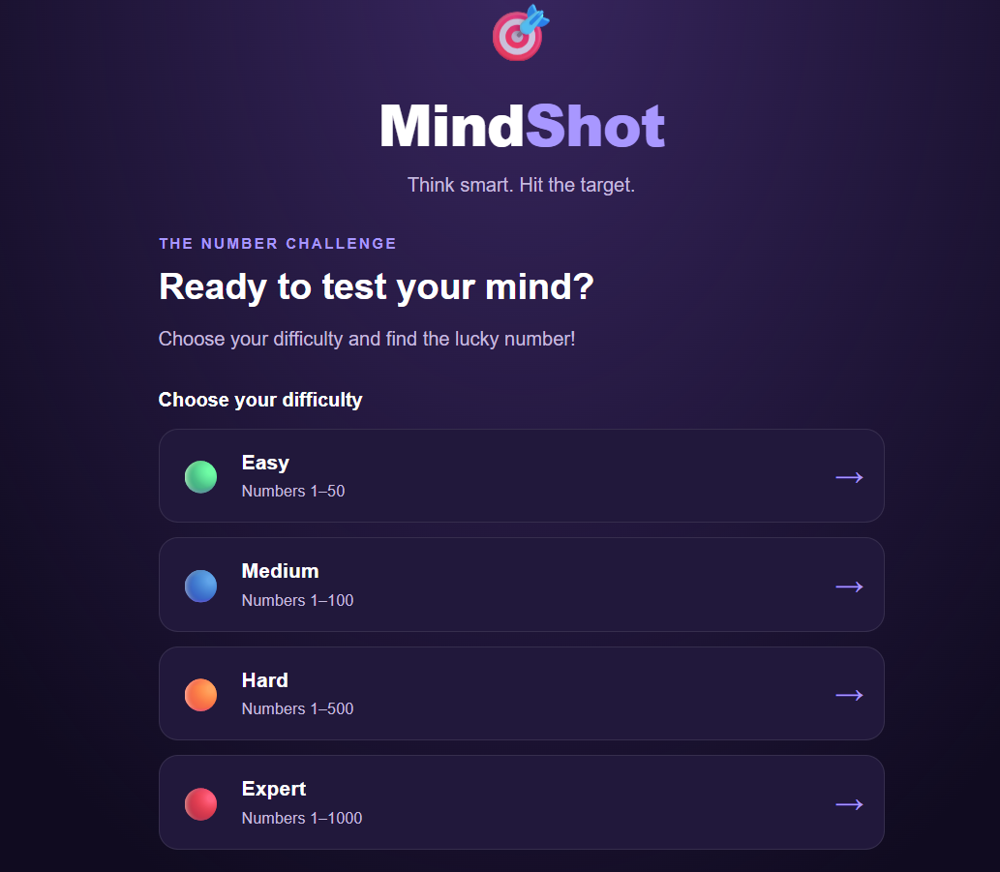
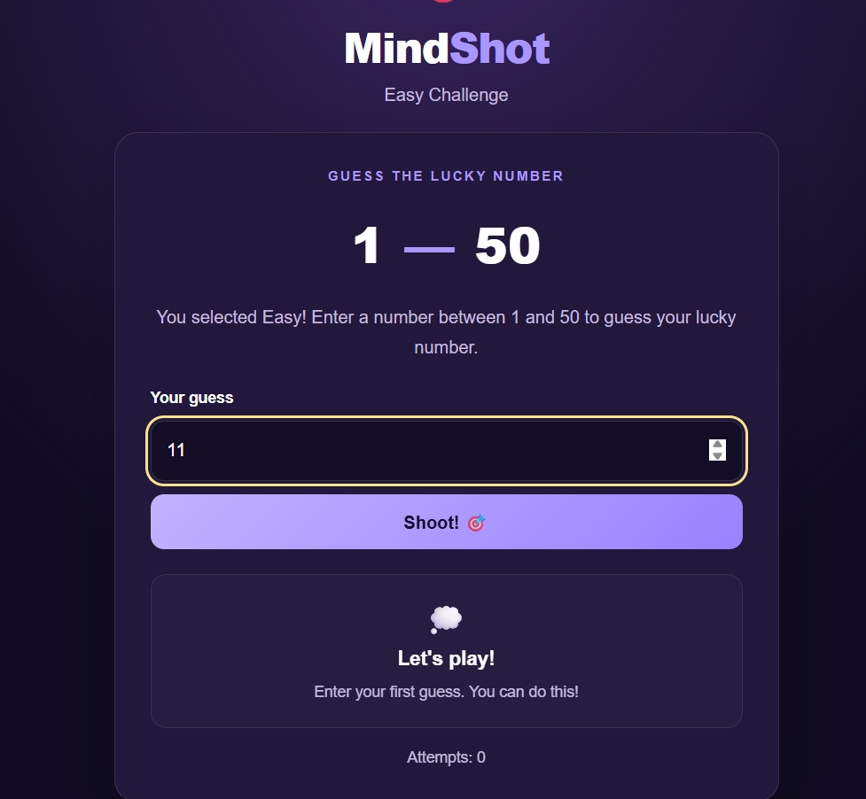
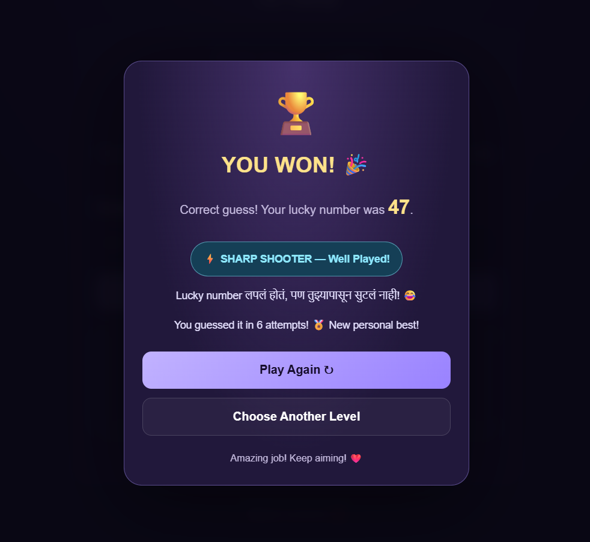

# 🎯 MindShot — Number Guessing Game

**Think smart. Guess fast. Hit the target!**

MindShot is a fun and interactive number guessing game built using HTML, CSS, and JavaScript. Challenge your guessing skills, choose your difficulty level, use hints, and try to find the secret number in as few attempts as possible!

🔗 **Live Demo:** [Play MindShot](https://mohitjagtap09.github.io/MindShot/)

---

## 📌 About the Project

MindShot is a browser-based number guessing game designed to make learning and playing fun. The computer generates a secret random number, and the player must guess it using the hints provided by the game.

Choose from four difficulty levels, improve your score, and challenge yourself to beat your personal best!

## ✨ Features

- 🎮 **Four Difficulty Levels** — Easy, Medium, Hard, and Expert.
- 🔢 **Random Number Generation** — A new secret number for each game.
- 💡 **Smart Hints** — Get hints like Too High or Too Low.
- 📊 **Attempt Counter** — Track the number of guesses you make.
- 🏆 **Best Score Tracking** — Save your best scores using browser Local Storage.
- 🎉 **Winning Popup** — Celebrate when you guess the correct number.
- 🔊 **Victory Applause** — Sound effect when you win.
- 😄 **Fun Quotes** — Enjoy funny messages while playing.
- 🔄 **Play Again** — Start a new challenge whenever you want.
- 📱 **Responsive Design** — Play on supported desktop and mobile browsers.

## 🎚️ Difficulty Levels

| Level | Number Range |
|---|---:|
| 🟢 Easy | 1–50 |
| 🔵 Medium | 1–100 |
| 🟠 Hard | 1–500 |
| 🔴 Expert | 1–1000 |

## 📸 Screenshots

### 🏠 Home Page



### 🎮 Gameplay



### 🏆 Winning Screen



## 🛠️ Technologies Used

- **HTML5** — Game structure and content.
- **CSS3** — Styling, layout, and visual design.
- **JavaScript** — Game logic, random number generation, hints, and score tracking.
- **Local Storage** — Stores best scores in the browser.
- **GitHub Pages** — Hosts the live game.

## 📂 Project Structure

```text
MindShot/
├── index.html       # Main game page
├── style.css        # Game styling
├── script.js        # Game logic
├── applause.mp3     # Victory sound effect
├── home.png         # Home page screenshot
├── playing.png      # Gameplay screenshot
├── winning.png      # Winning screen screenshot
└── README.md        # Project documentation
```

## 🚀 How to Play

1. Open the [MindShot Game](https://mohitjagtap09.github.io/MindShot/).
2. Select your preferred difficulty level.
3. Enter a number within the selected range.
4. Click the Guess button.
5. Follow the hints to guess the secret number.
6. Try to win using as few attempts as possible.
7. Play again and beat your best score!

## 💻 Run Locally

Want to run MindShot on your computer?

1. Clone or download this repository.
2. Open the project folder.
3. Open `index.html` in your web browser.
4. Start guessing and enjoy the game!

Alternatively, use the VS Code Live Server extension to run the project locally.

## 🎯 Project Goals

- Practice JavaScript programming and game logic.
- Understand random number generation and conditional statements.
- Learn how to use browser Local Storage.
- Improve frontend development skills.
- Learn GitHub repository management and GitHub Pages deployment.

## 🔮 Future Improvements

- ⏱️ Add a timer mode.
- 🌍 Add a global leaderboard.
- 🎨 Add more themes and visual effects.
- 🥇 Add achievements and badges.
- 📈 Add detailed game statistics.

## 👨‍💻 Author

**Mohit Jagtap**

- GitHub: [@mohitjagtap09](https://github.com/mohitjagtap09)
- Project Repository: [MindShot on GitHub](https://github.com/mohitjagtap09/MindShot)
- Live Game: [Play MindShot](https://mohitjagtap09.github.io/MindShot/)

## 📄 License

This project is available for learning and personal use. A formal open-source license has not yet been added.

---

⭐ **If you like MindShot, consider starring the repository on GitHub!**

*Made with ❤️ and JavaScript.*
